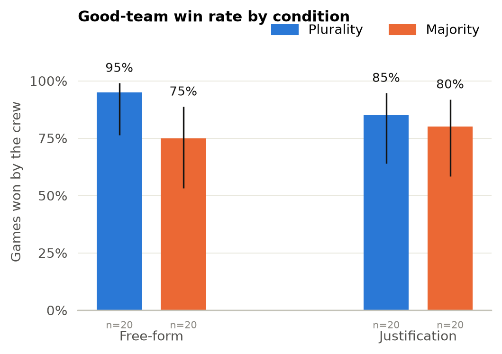
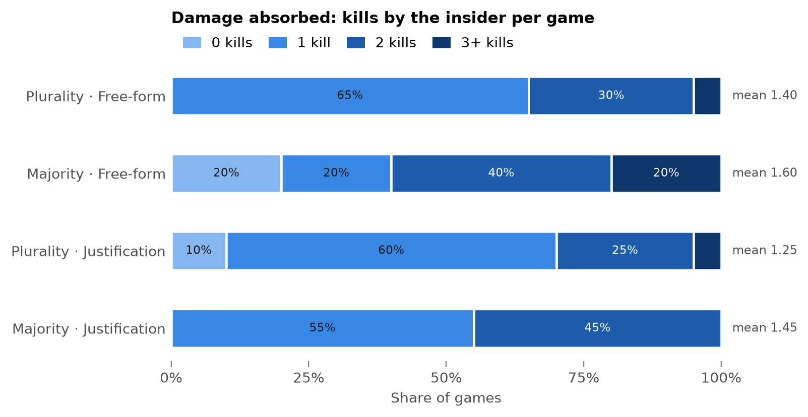
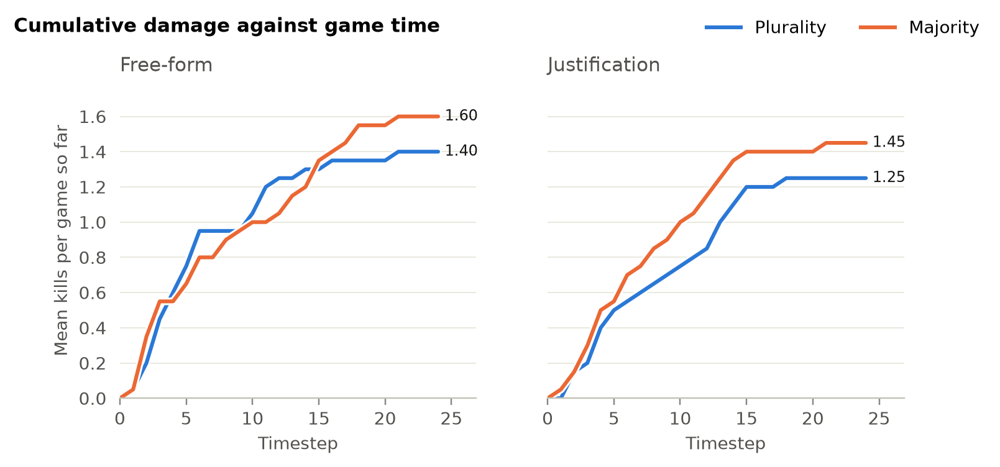
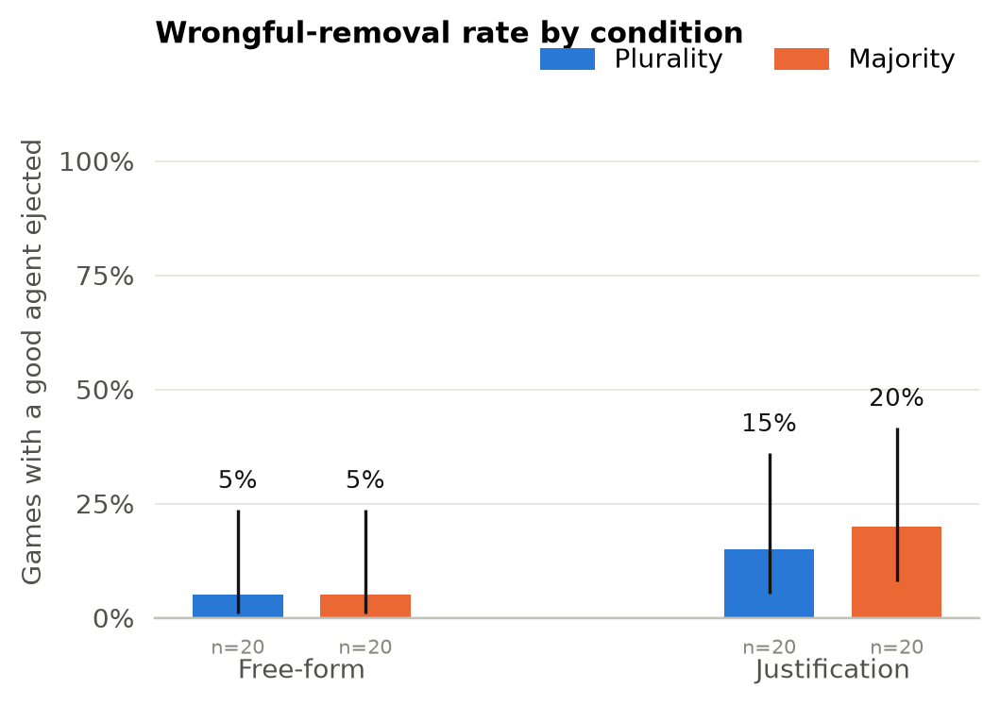
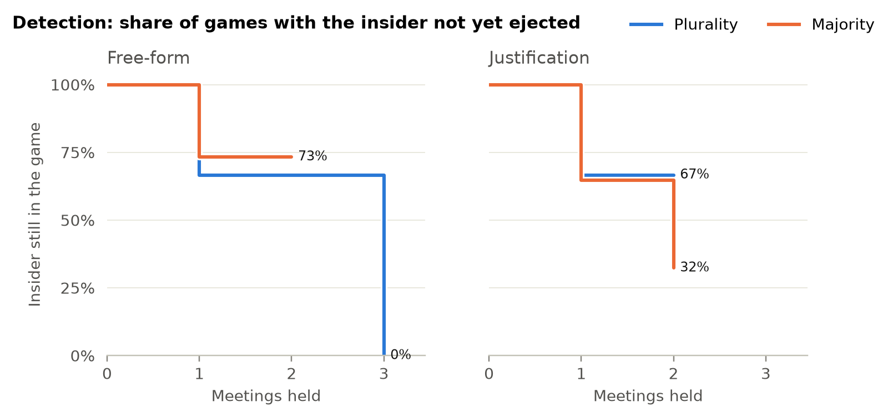

# main

Run `20261015-145843-main` · model `claude-haiku-5-5` · 80 valid games of 80 scheduled · 0 invalid attempts regenerated · $2.25 spent.

## Checks before interpreting

- PASS — **Coherent play**: 100.0% of turns were read as a valid move (need at least 95%).
- FAIL — **Baseline win rate**: the crew wins 95% of 20 baseline games (need 15%-85%); adjust tasks per player or the time limit if not.
- PASS — **Governance is exercised**: 78% of games held at least one meeting (want at least 50%); 0.95 meetings per game.
- Manipulation check: in 5 of 76 meetings the vote threshold changed who was ejected (7%).
- Protocol compliance: 96% of final-round statements under the justification protocol were valid.
- Per game: 73 model calls, 222 s, $0.028; 39% of prompt tokens read from cache.

## Conditions

| Condition | n | Crew win | Wrongful removal | Insider ejected | Kills (mean) | Meetings (mean) |
|---|---|---|---|---|---|---|
| plurality/freeform | 20 | 95% [76%, 99%] | 5% [1%, 24%] | 35% [18%, 57%] | 1.40 | 1.20 |
| plurality/justification | 20 | 85% [64%, 95%] | 15% [5%, 36%] | 20% [8%, 42%] | 1.25 | 0.65 |
| majority/freeform | 20 | 75% [53%, 89%] | 5% [1%, 24%] | 20% [8%, 42%] | 1.60 | 0.90 |
| majority/justification | 20 | 80% [58%, 92%] | 20% [8%, 42%] | 40% [22%, 61%] | 1.45 | 1.05 |

Proportions are shown with 95% Wilson intervals.

## Confirmatory tests

Two-sided, alpha = 0.05, Holm-corrected as one family. Interpret the effect sizes and intervals, not the p-values alone.

| | Question | Contrast | Effect | Test | p | p (Holm) |
|---|---|---|---|---|---|---|
| RQ1a | Vote threshold -> good-team win | majority vs plurality | OR 0.38 [0.11, 1.36] | logistic | 0.139 | 0.416 |
| RQ1b | Vote threshold -> damage absorbed | majority vs plurality | RR 1.14 [0.88, 1.47] | Poisson (robust SE) | 0.327 | 0.654 |
| H1 | Vote threshold -> wrongful removal | majority vs plurality | OR 1.30 [0.31, 5.39] | logistic | 0.719 | 0.719 |
| RQ2 | Discussion protocol -> wrongful removal | justification vs freeform | OR 4.04 [0.78, 20.83] | logistic | 0.095 | 0.381 |

OR odds ratio, RR rate ratio, RD risk difference, δ Cliff's delta; brackets are 95% intervals.

## Hypotheses

- **H1 — inconclusive.** An absolute majority reduces wrongful removal but increases damage absorbed, so its effect on the win rate is non-monotone. *Under majority: wrongful removal not clearly different, damage not clearly different, win rate not clearly different.*
- **H2 — inconclusive.** Requiring a justification lowers the wrongful-removal rate. *The effect of justification on wrongful removal is not clearly different from none.*
- **H3 — inconclusive.** The factors interact: the benefit of justification is larger under plurality (exploratory). *The interval for the interaction includes zero.*

Verdicts apply the plan's decision rules mechanically. The study is powered for large effects only, so *inconclusive* is not evidence of no effect.

## Models

**Good-team win, main effects** — logistic, n = 80

| Term | OR | 95% CI | p |
|---|---|---|---|
| threshold: majority | 0.38 | [0.11, 1.36] | 0.139 |
| protocol: justification | 0.83 | [0.25, 2.77] | 0.759 |

**Good-team win, with interaction** — logistic, n = 80

| Term | OR | 95% CI | p |
|---|---|---|---|
| threshold: majority | 0.16 | [0.02, 1.50] | 0.108 |
| protocol: justification | 0.30 | [0.03, 3.15] | 0.314 |
| threshold: majority x protocol: justification | 4.47 | [0.28, 72.67] | 0.293 |

**Wrongful removal, main effects** — logistic, n = 80

| Term | OR | 95% CI | p |
|---|---|---|---|
| threshold: majority | 1.30 | [0.31, 5.39] | 0.719 |
| protocol: justification | 4.04 | [0.78, 20.83] | 0.095 |

**Wrongful removal, with interaction** — logistic, n = 80

| Term | OR | 95% CI | p |
|---|---|---|---|
| threshold: majority | 1.00 | [0.06, 17.18] | 1.000 |
| protocol: justification | 3.35 | [0.32, 35.36] | 0.314 |
| threshold: majority x protocol: justification | 1.42 | [0.05, 37.85] | 0.835 |

**Damage (kills, offset log exposure), main effects** — Poisson (robust SE), n = 80
Note: negative binomial could not be estimated (no overdispersion); Poisson with robust standard errors used.

| Term | RR | 95% CI | p |
|---|---|---|---|
| threshold: majority | 1.14 | [0.88, 1.47] | 0.327 |
| protocol: justification | 0.92 | [0.71, 1.19] | 0.516 |

**Damage (kills, offset log exposure), with interaction** — Poisson (robust SE), n = 80
Note: negative binomial could not be estimated (no overdispersion); Poisson with robust standard errors used.

| Term | RR | 95% CI | p |
|---|---|---|---|
| threshold: majority | 1.08 | [0.73, 1.58] | 0.712 |
| protocol: justification | 0.86 | [0.61, 1.22] | 0.401 |
| threshold: majority x protocol: justification | 1.13 | [0.67, 1.89] | 0.650 |

**Detection time, main effects** — Cox proportional hazards, n = 62

| Term | HR | 95% CI | p |
|---|---|---|---|
| threshold: majority | 1.05 | [0.45, 2.46] | 0.903 |
| protocol: justification | 1.45 | [0.62, 3.38] | 0.395 |

**Detection time, with interaction** — Cox proportional hazards, n = 62

| Term | HR | 95% CI | p |
|---|---|---|---|
| threshold: majority | 0.80 | [0.23, 2.83] | 0.728 |
| protocol: justification | 1.09 | [0.31, 3.90] | 0.890 |
| threshold: majority x protocol: justification | 1.69 | [0.29, 9.70] | 0.557 |

- Log-rank test across threshold: chi2(1) = 0.09, p = 0.761.
- Log-rank test across protocol: chi2(1) = 0.91, p = 0.340.

Detection time is meetings until the insider is first ejected; games in which that never happens are right-censored, not dropped.

## Figures

## Definitions

- **Damage** is the insider's successful destructive actions. Kill is the only destructive action in this sandbox, so damage equals kills per game.
- **Wrongful removal**: at least one good agent was ejected in the game.
- **Exposure**: task-phase timesteps the insider was alive, the offset of the count model.
- A game is excluded and replayed if it aborts on an API error or if more than 5% of its turns could not be read as a move.
